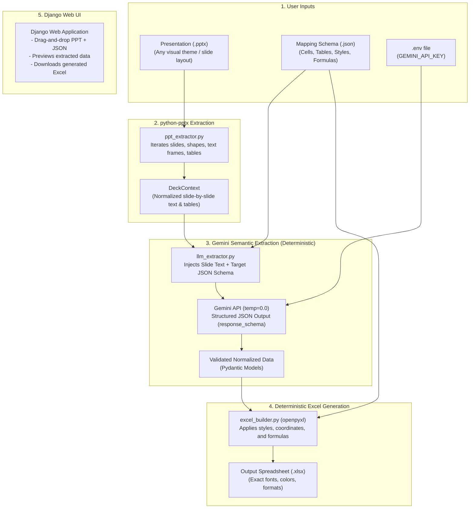

# Implementation Plan: Deterministic PPT to XLS Converter (Django + Gemini + python-pptx + openpyxl)

## Goal Description
Build an automated, deterministic Python tool with a **Django web interface** that converts PowerPoint presentations (`.pptx`) into styled Excel workbooks (`.xlsx`) governed by a user-provided JSON mapping schema.
The tool uses **Python venv** for isolation, reads the Gemini API key from a `.env` file, uses **`python-pptx`** to parse presentation internals, leverages **Gemini LLM** (`temperature=0.0`) for semantic content extraction, and uses **`openpyxl`** for pixel-perfect, deterministic formatting (fonts, colors, sizes, borders, number formatting, and formulas).

---

## Architecture & End-to-End Flow

---

## Technical Design & Principles (KISS & DRY)

### 1. `python-pptx` Parser
- Iterates over slides and extracts plain text from all shapes (text boxes, titles, callouts) and 2D arrays from all tables.
- Formats this as clean, readable Markdown/text with slide markers (`Slide 1: ...`, `Slide 2: ...`).

### 2. Gemini Semantic Extractor
- Reads mapping configuration:
  - Fixed cells (e.g., `total_budget`, `headcount`)
  - Repeating tables (e.g., department budget items: `dept_name`, `planned`, `actual`)
- Constructs a dynamic prompt instructing Gemini to extract values strictly adhering to the JSON schema.
- Runs with `temperature=0.0` for deterministic, repeatable output.

### 3. `openpyxl` Deterministic Formatter
- Reads style specifications (font family, font size, bold, italic, colors, fills, borders, number formatting like `$#,##0` or `0.0%`).
- Injects cell values at specified coordinates.
- Expands table rows dynamically and writes native Excel formulas (e.g. `={planned}-{actual}`).

### 4. Django Web App
- Single-page minimal app:
  - File upload inputs for `.pptx` and `.json`.
  - "Load Demo Assets" button to test instantly without manual file picking.
  - Conversion action with extraction preview table and instant `.xlsx` download.

### 5. Test Data Generator
- `generate_test_assets.py` creating:
  - `sample_budget_deck.pptx` (corporate layout)
  - `sample_budget_variant_deck.pptx` (different fonts, colors, slide structures)
  - `budget_mapping.json` (schema and formatting rules)
- `verify_determinism.py` to assert identical outputs from both decks.
