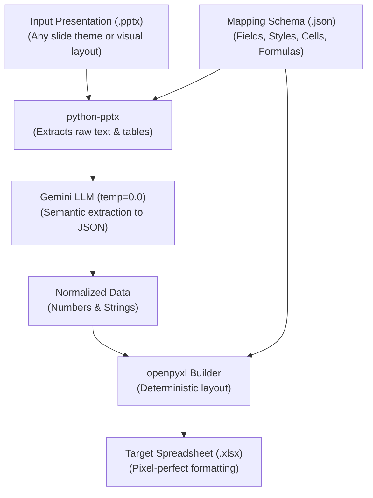

# Deterministic PPT to XLS Converter

An automated tool with a lightweight Django web interface that converts PowerPoint presentations (`.pptx`) into styled Excel spreadsheets (`.xlsx`) driven by a declarative JSON mapping schema.

Powered by:
- **`python-pptx`**: OpenXML presentation parsing (slides, shapes, text frames, tables).
- **Google Gemini LLM** (`temperature=0.0`): Semantic content understanding and normalized extraction.
- **`openpyxl`**: Deterministic Excel workbook generation (fonts, sizes, colors, borders, number formatting, and native formulas).
- **Django**: Clean, minimal web UI for drag-and-drop file processing, data previews, and Excel downloads.

---

## 🎯 The Core Problem & Determinism Strategy

Presentations are visually fluid: different teams format their slides with custom fonts, colors, bullet styles, card layouts, or tables with varying column orders. Traditional regex or positional scrapers break immediately.

To guarantee **100% deterministic output** regardless of how a presentation looks:

1. **Semantic Extraction (Gemini LLM)**:
   - Runs with `temperature=0.0` and structured JSON schema output.
   - Extracts semantic values (e.g. `total_budget`, `headcount`, `departments`) regardless of whether they appear in tables, bullet points, or floating shapes.
   - Normalizes all messy text (`"$4.5M"`, `"$4,500,000"`, `"85 FTEs"`) into clean numerical values (`4500000`, `85`).

2. **Deterministic Formatting (`openpyxl`)**:
   - Python code enforces all visual styling (font family, font size, cell background fills, font colors, borders, and currency formats like `$#,##0`).
   - The LLM **never** touches Excel formatting or binary files.
   - Formulas (such as `Remaining = Planned - Actual`) are injected as native Excel formulas (e.g. `=B8-C8`), ensuring complete mathematical accuracy.



---

## 📁 Project Structure

```text
ppttoxls/
├── .env.example                  # Environment configuration template
├── .env                          # Local environment variables (GEMINI_API_KEY)
├── requirements.txt              # Project dependencies
├── manage.py                     # Django management CLI
├── README.md                     # Documentation
├── IMPLEMENTATION_PLAN.md        # Technical design plan
├── generate_test_assets.py       # Script to generate sample PPT decks & mapping
├── verify_determinism.py         # Automated determinism verification script
├── test_django_endpoints.py      # End-to-end Django endpoint test
│
├── core/                         # Core conversion engine (KISS & DRY)
│   ├── __init__.py
│   ├── models.py                 # Pydantic schemas for mapping config
│   ├── ppt_extractor.py          # python-pptx slide parsing
│   ├── llm_extractor.py          # Gemini structured prompt & extraction
│   ├── excel_builder.py          # openpyxl deterministic Excel builder
│   └── converter.py              # Main conversion pipeline orchestration
│
├── ppttoxls_web/                 # Django project settings
│   ├── __init__.py
│   ├── settings.py
│   ├── urls.py
│   └── wsgi.py
│
├── converter/                    # Django converter web app
│   ├── __init__.py
│   ├── apps.py
│   ├── urls.py
│   ├── views.py                  # Upload, conversion, and download endpoints
│   └── templates/
│       └── converter/
│           └── index.html        # Responsive Bootstrap 5 interface
│
└── test_assets/                  # Sample presentations & mapping schemas
    ├── sample_budget_deck.pptx          # Standard corporate layout
    ├── sample_budget_variant_deck.pptx  # Different design & layout (tests determinism)
    └── budget_mapping.json              # Sample JSON mapping configuration
```

---

## 🚀 Quickstart Guide

### 1. Prerequisites
- Python 3.10+ (tested on Python 3.13)
- Windows / macOS / Linux

### 2. Virtual Environment Setup
Create and activate your virtual environment:

```powershell
# Create venv
python -m venv .venv

# Activate on Windows (PowerShell)
.venv\Scripts\Activate.ps1

# Activate on macOS/Linux
source .venv/bin/activate
```

### 3. Install Dependencies
```powershell
pip install -r requirements.txt
```

### 4. Configure API Key
Copy `.env.example` to `.env` and insert your Google Gemini API key:

```ini
GEMINI_API_KEY=AIzaSy...your_gemini_api_key_here
DJANGO_SECRET_KEY=django-insecure-ppt-to-xls-converter-poc-key-2025
DEBUG=True
```

---

## 🧪 Verification & Test Assets

Run the automated test asset generator to create the sample budget presentations and mapping JSON:

```powershell
python generate_test_assets.py
```

Run the determinism verification script:
```powershell
python verify_determinism.py
```

This verifies that:
1. `sample_budget_deck.pptx` (standard corporate deck) and `sample_budget_variant_deck.pptx` (different visual styling, card shapes, and reversed column orders) parse properly.
2. Cell coordinates, labels, and numbers (`$4,500,000`, `85` FTEs) match exactly.
3. Excel styles (font `Segoe UI`, colors, currency format `$#,##0`) and dynamic formulas (`=B8-C8`) match the JSON specification.

---

## 🌐 Running the Web UI

Start the Django development server:

```powershell
python manage.py runserver
```

Open your browser to: **`http://127.0.0.1:8000/`**

### Features:
- **Demo Mode (One-Click)**: Test immediately with the pre-loaded budget presentation without needing to pick files.
- **Variant Deck Toggle**: Switch between the standard deck and the variant styled deck to observe determinism in action.
- **Custom Upload**: Upload your own `.pptx` and `.json` mapping schema.
- **Interactive Preview**: Inspect normalized extracted data, table rows, and raw PowerPoint slide text.
- **Download**: One-click download of the generated `.xlsx` workbook.

---

## 📋 JSON Mapping Schema Format

Below is an example of the declarative JSON mapping schema (`budget_mapping.json`):

```json
{
  "title": "Corporate Budget Plan Export",
  "sheets": [
    {
      "name": "Budget_Summary",
      "styles": {
        "header": {
          "font": "Segoe UI",
          "size": 11,
          "bold": true,
          "bg_color": "#2F5597",
          "font_color": "#FFFFFF",
          "align": "center",
          "border": "thin"
        },
        "currency": {
          "font": "Segoe UI",
          "size": 11,
          "num_format": "$#,##0",
          "align": "right",
          "border": "thin"
        },
        "text": {
          "font": "Segoe UI",
          "size": 11,
          "align": "left",
          "border": "thin"
        }
      },
      "cells": [
        {
          "cell": "B2",
          "key": "fiscal_year",
          "type": "string",
          "description": "Fiscal year identifier",
          "style": "text",
          "label": "Fiscal Year:",
          "label_cell": "A2"
        },
        {
          "cell": "B3",
          "key": "total_budget",
          "type": "number",
          "description": "Total approved company budget",
          "style": "currency",
          "label": "Total Approved Budget:",
          "label_cell": "A3"
        }
      ],
      "tables": [
        {
          "key": "departments",
          "start_cell": "A7",
          "description": "Department breakdown of planned spend and actuals",
          "columns": [
            { "header": "Department", "key": "dept_name", "type": "string", "style": "text", "width": 25 },
            { "header": "Planned Budget", "key": "planned", "type": "number", "style": "currency", "width": 20 },
            { "header": "Q1 Actual", "key": "actual", "type": "number", "style": "currency", "width": 20 },
            { "header": "Remaining Budget", "key": "remaining", "type": "formula", "formula": "={planned}-{actual}", "style": "currency", "width": 22 }
          ]
        }
      ]
    }
  ]
}
```
